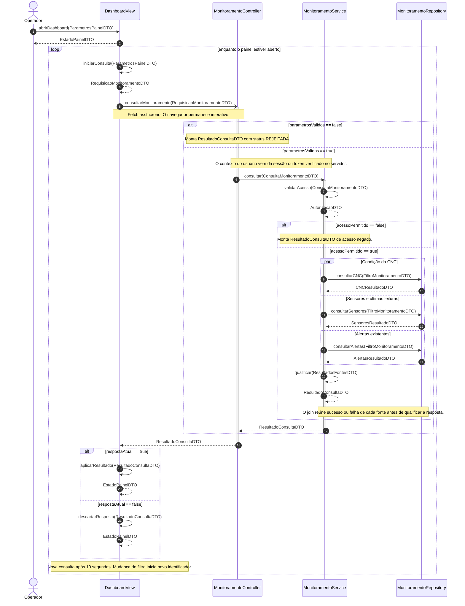
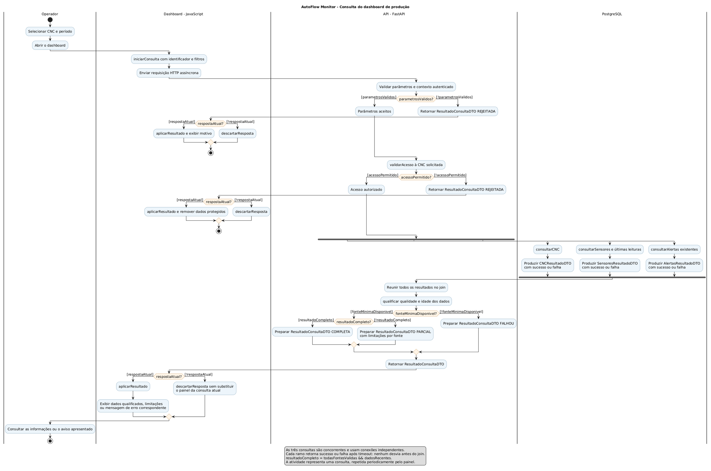
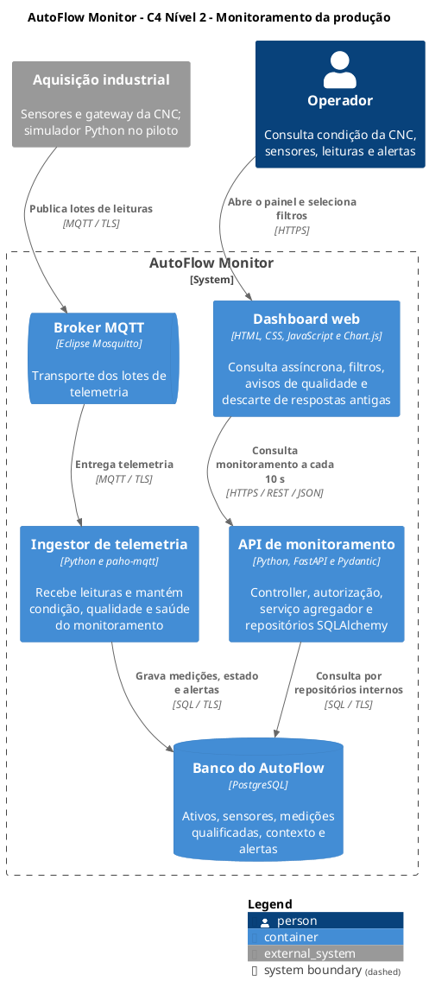

# APS 3 - Dossiê de Arquitetura Viva

AutoFlow Monitor: Monitoramento da produção

Aluno: Phillipe Mugnaini  
Curso: Engenharia de Software, 4º período - UniSenai  
Unidade curricular: Modelagem de Software  
Docente: Prof. Sidney L. da Silva  
Referência: RF09 e UC01  
Ator principal: Operador

## Funcionalidade escolhida

Permitir que o operador acompanhe a produção por meio de um dashboard, consultando a condição da CNC, os sensores, os últimos dados recebidos e os alertas existentes.

O AutoFlow Monitor pertence ao cenário de uma fábrica de carcaças de alumínio para bombas d'água automotivas. O dossiê representa a consulta das informações já recebidas pelo sistema. Sua entrega reúne os cinco artefatos sobre essa mesma funcionalidade.

A solução recebe telemetria em segundo plano. Para visualizar o monitoramento, o operador seleciona a CNC e o período, a interface consulta a API, o serviço verifica o acesso e reúne dados do PostgreSQL. A resposta indica informações utilizáveis, dados antigos, falhas de fonte e permissões.

## Fluxo e fronteiras

1. O operador abre o dashboard e seleciona os filtros.
2. O navegador inicia uma consulta identificada, sem bloquear a interação.
3. A API valida parâmetros e autorização sobre a CNC.
4. O serviço consulta condição da CNC, sensores/leituras e alertas em paralelo.
5. O join aguarda os três resultados; qualidade, idade e disponibilidade são avaliadas.
6. A interface aplica apenas a resposta correspondente à consulta atual.
7. Um novo ciclo periódico é proposto a cada 10 segundos, conforme a Sprint 1.

O painel mostra condição da CNC, saúde dos sensores e estados dos alertas como informações separadas. Leituras antigas ou uma fonte indisponível nunca são apresentadas como confirmação de normalidade.

## Entidade do ciclo de vida

ConsultaMonitoramento representa uma execução dessa funcionalidade, com consultaId, solicitante, filtros, instantes e resultado. É um refinamento de modelagem proposto para esta APS e não exige uma tabela adicional.

A máquina de estados acompanha a consulta até sua exibição, descarte, rejeição ou falha. Ela utiliza subestados para autorização, carregamento e qualificação. Cada atualização do painel cria outra consulta e outro identificador.

A condição da CNC continua sendo um dado monitorado. Concluir uma consulta não muda o estado físico do equipamento e não reconhece ou encerra alertas.

## Artefato 1 - Diagrama de sequência

Comunicação do operador, interface, controller, serviço e repositório durante a consulta.

Fonte: [sequencia.mmd](docs/diagrams/sequencia.mmd).




## Artefato 2 - Atividades com raias

Uma consulta, com autorização, três carregamentos concorrentes, join e apresentação qualificada.

Fonte: [atividades.puml](docs/diagrams/atividades.puml).


<details>
<summary>Fonte PlantUML</summary>



</details>


## Artefato 3 - Máquina de estados

Ciclo de vida de ConsultaMonitoramento, incluindo rejeição, falha e descarte de resposta antiga.

Fonte: [estados.mmd](docs/diagrams/estados.mmd).

```mermaid
stateDiagram-v2
    direction TB
    [*] --> Criada

    Criada: entry / registrarIdentificador()
    Criada --> EmProcessamento: iniciarConsulta [parametrosValidos] / registrarInicio()
    Criada --> Pronta: validarParametros [!parametrosValidos] / prepararRejeicao()

    state EmProcessamento {
        direction TB
        [*] --> ValidandoAcesso
        ValidandoAcesso: do / verificarPermissao()
        ValidandoAcesso --> ConsultandoFontes: autorizar [acessoPermitido] / iniciarConsultasParalelas()
        ConsultandoFontes: do / aguardarTodosOsResultados()
        ConsultandoFontes --> QualificandoDados: concluirConsultas [todasFinalizadas] / reunirResultados()
        QualificandoDados: do / avaliarQualidadeEAtualidade()
    }

    EmProcessamento: entry / registrarInicioProcessamento()
    EmProcessamento: exit / registrarFimProcessamento()

    EmProcessamento --> Pronta: negarAcesso [emValidacaoAcesso && !acessoPermitido] / prepararRejeicao()
    EmProcessamento --> Pronta: prepararResposta [emQualificacao] / registrarResultadoQualificado()
    EmProcessamento --> Pronta: falharConsulta [falhaTecnica] / prepararFalha()

    Pronta: entry / registrarFimConsulta()
    Pronta: do / aguardarAplicacaoNoPainel()
    state AplicandoResultado <<choice>>
    Pronta --> AplicandoResultado: aplicarResposta [respostaAtual] / classificarResultado()
    Pronta --> Descartada: aplicarResposta [!respostaAtual] / ignorarResposta()
    AplicandoResultado --> Exibida: [resultadoDisponivel] / atualizarDados()
    AplicandoResultado --> Rejeitada: [resultadoRejeitado] / exibirMotivo()
    AplicandoResultado --> Falhou: [resultadoFalha] / exibirIndisponibilidade()

    Exibida --> [*]
    Descartada --> [*]
    Rejeitada --> [*]
    Falhou --> [*]
```


## Artefato 4 - Visão de contêineres C4 L2

Aplicações e armazenamento que sustentam o monitoramento, com tecnologias e protocolos.

Fonte: [workspace.puml](docs/architecture/workspace.puml).


<details>
<summary>Fonte PlantUML</summary>



</details>


## Artefato 5 - Registro de Decisão Arquitetural

Fonte: [adr-0001.md](docs/architecture/adr-0001.md).

### ADR 0001 - API agregadora com consultas concorrentes e resposta qualificada

#### Status

Proposto. Data: 10/11/2026. Projeto: AutoFlow Monitor. Funcionalidade: Monitoramento da produção, RF09 e UC01.

#### Contexto

O operador precisa acompanhar condição da CNC, sensores, últimos dados e alertas em um único painel. Essas informações possuem origens lógicas e horários distintos. Consultas lentas, falhas parciais e respostas fora de ordem podem fazer o painel exibir dados antigos como atuais ou indicar ausência de alertas quando a consulta falhou.

A Sprint 1 propõe HTML, CSS, JavaScript e Chart.js para o dashboard; Python/FastAPI, SQLAlchemy e PostgreSQL no backend. Também propõe atualização a cada 10 segundos e exige indicação da qualidade e idade dos dados.

#### Decisão

Adotar uma operação agregadora de consulta na API FastAPI. O navegador solicita os filtros e recebe ResultadoConsultaDTO com consultaId, ativoId, status, dados qualificados, consultadoEm e avisos.

O controller valida parâmetros e estabelece o contexto autenticado. O serviço verifica o acesso à CNC antes de disparar três consultas concorrentes: condição da CNC, sensores/leituras e alertas. Cada tarefa usa uma conexão própria e possui timeout. Falhas são capturadas e cada ramo retorna ao join.

O serviço qualifica o conjunto como COMPLETA, PARCIAL, REJEITADA ou FALHOU. O painel preserva horário e qualidade das informações e não confunde fonte indisponível com condição normal ou ausência de alertas.

A consulta é iniciada por fetch assíncrono. A interface verifica consultaId e ativoId antes de aplicar a resposta. A mudança de filtro invalida a consulta anterior. A atualização periódica é proposta a cada 10 segundos, evitando iniciar ciclos periódicos sobrepostos; a meta de até 15 segundos após o aceite no servidor permanece um critério a medir no piloto.

#### Alternativas consideradas

| Alternativa | Benefício | Limitação |
| --- | --- | --- |
| Três requisições independentes pelo navegador | Facilita separar os carregamentos. | Espalha autorização, tratamento de falhas e regras de qualidade na interface. |
| Uma operação com consultas sequenciais | Simplifica conexões e fluxo inicial. | Os tempos das três consultas se somam. |
| Uma operação com consultas concorrentes e qualificação | Centraliza o contrato, reúne os resultados e explicita falhas parciais. | Exige sessões independentes, timeouts, join e limite de concorrência. |
| Push por WebSocket | Pode reduzir espera por novos dados. | Acrescenta gestão de conexão e reconexão; o polling já consta da proposta do piloto. |

A concorrência é uma escolha de organização da consulta. Não há benchmark comprovando ganho de latência ou necessidade de escala para o piloto.

#### Consequências

##### Vantagens

- Contrato único para a visualização de monitoramento.
- Autorização centralizada antes da consulta dos dados.
- Tratamento explícito de informações ausentes, antigas ou indisponíveis.
- Respostas obsoletas não substituem a consulta atual.
- Fonte com falha não elimina automaticamente as informações úteis das demais.

##### Riscos e débitos aceitos

- Até três consultas usam o pool de conexões por solicitação.
- É necessário limitar concorrência e tempo de espera por tarefa.
- Resultados podem representar instantes diferentes; o DTO não é um snapshot transacional único.
- Polling tem atraso de atualização e gera carga mesmo sem mudança dos dados.
- O status PARCIAL exige apresentação clara das limitações.

##### Governança e mitigação

O frontend chama a API; controller e interface não executam SQL. Regras de qualificação pertencem ao serviço. Repositórios usam filtros parametrizados e escopo de autorização.

A UI aplica apenas a resposta atual, mostra o horário da última informação e diferencia zero alertas de falha ao consultar alertas. Após rejeição de acesso, elimina dados protegidos do painel.

Mudanças de protocolo, contrato de resposta ou significado dos estados devem atualizar diagramas, interfaces e esta ADR. Uma decisão substituta deve ser registrada se o projeto adotar push ou exigir snapshot transacional.

#### Critérios de validação futura da implementação

Testar usuário sem permissão, filtro inválido, atraso e falha de cada fonte, todos os dados indisponíveis, leituras antigas, retorno vazio de alertas, troca rápida de CNC, respostas fora de ordem e carga do piloto com atualização até 15 segundos após o aceite no servidor.

Esses são ensaios planejados da aplicação. A compilação dos modelos verifica sintaxe e consistência documental.

#### Referências

- [FastAPI: concorrência e async/await](https://fastapi.tiangolo.com/async/).
- [Python: tarefas assíncronas](https://docs.python.org/3/library/asyncio-task.html).
- [PostgreSQL: isolamento transacional](https://www.postgresql.org/docs/current/transaction-iso.html).
- Sprint 1 e Sprint 2 do AutoFlow Monitor.


## Interfaces e consistência entre modelos

As classes/interfaces públicas e os DTOs estão declarados em [interfaces.py](docs/contracts/interfaces.py). São contratos conceituais, sem implementação da aplicação. O arquivo [consistencia.md](docs/contracts/consistencia.md) define as guardas, os resultados e os pontos de integração.

| Participante da sequência | Interface pública | Papel |
| --- | --- | --- |
| WEB | DashboardView | Iniciar consulta e aplicar ou descartar resposta. |
| API | MonitoramentoController | Receber requisição e validar contrato/contexto autenticado. |
| SVC | MonitoramentoService | Autorizar, agregar e qualificar os resultados. |
| REP | MonitoramentoRepository | Consultar CNC, sensores/leituras e alertas. |

Todas as mensagens de chamada da sequência correspondem a operações públicas dessas interfaces. Os retornos usam DTOs. A seta -) indica o envio assíncrono por fetch; ->> indica chamada com espera lógica pelo resultado.

A sequência apresenta os ciclos periódicos do painel; a atividade detalha um ciclo; os estados acompanham a consulta desse ciclo; o C4 posiciona os participantes e os protocolos; a ADR explica as decisões comuns.

## Significado dos resultados

| Resultado | Efeito no painel |
| --- | --- |
| COMPLETA | Exibir os dados válidos e recentes das fontes. |
| PARCIAL | Exibir informações utilizáveis com avisos claros de ausência, atraso ou falha por fonte. |
| REJEITADA | Exibir o motivo apropriado e preservar o controle de acesso. |
| FALHOU | Informar que não foi possível obter o resultado mínimo. |

Uma lista vazia de alertas, obtida com sucesso, significa ausência de registros no filtro. Erro ao consultar alertas significa informação indisponível. Falha de consulta não comprova falha física do sensor.

## Atendimento à atividade

| Artefato | Evidência |
| --- | --- |
| Sequência | Cinco linhas de vida, chamadas síncronas e assíncronas, loop, alt/else, par e retornos DTO. |
| Atividades | Quatro raias, guardas booleanas opostas e barras UML de fork/join. |
| Estados | Estado inicial, subestados, quatro resultados terminais e transições com gatilho, guarda e efeito; entry, do e exit. |
| C4 L2 | Contêineres identificados com tecnologias e conectores com protocolos. |
| ADR 0001 | Título, status Proposto, contexto, decisão, alternativas e consequências. |

A escolha de PlantUML nas atividades permite representar raias e barras UML de fork/join diretamente. O arquivo de arquitetura usa a biblioteca C4-PlantUML. Essas alternativas são permitidas no enunciado; por isso as extensões correspondentes são .puml.

## Arquivos da entrega

| Caminho | Conteúdo |
| --- | --- |
| README.md | Documento principal com os cinco artefatos. |
| docs/diagrams/sequencia.mmd | Fonte Mermaid da sequência. |
| docs/diagrams/atividades.puml | Fonte PlantUML das atividades com raias. |
| docs/diagrams/estados.mmd | Fonte Mermaid da máquina de estados. |
| docs/architecture/workspace.puml | Fonte C4-PlantUML do nível 2. |
| docs/architecture/adr-0001.md | Registro de decisão arquitetural. |
| docs/contracts/ | Operações públicas, DTOs e regras de consistência. |
| docs/images/ | SVGs das fontes PlantUML, com identificação da versão da fonte. |
| docs/README.base.md | Texto-base usado para gerar este README. |
| scripts/ | Geração da documentação e verificações de consistência. |

## Visualização, atualização e validação

O GitHub renderiza os blocos Mermaid do README. As atividades e o C4 já possuem SVGs versionados, gerados das respectivas fontes PlantUML.

Para revisar o texto, editar docs/README.base.md. Para revisar os modelos, editar os arquivos de origem. Depois, gerar novamente a documentação e registrar as alterações reais no Git.

Requisitos para regeneração: Node.js 20 ou superior, Python 3.10 ou superior, Java 17 ou superior e Graphviz.

~~~bash
npm ci
npm run docs
npm run check
~~~

O gerador obtém PlantUML 1.2026.9 e verifica seu SHA-256. Também aceita o caminho de um JAR dessa versão na variável PLANTUML_JAR. O CI compila os modelos e verifica operações, DTOs, fontes e README.

O material é de modelagem. Não há aplicação, banco industrial ou integração MQTT executável neste pacote. A meta RNF01 de até 15 segundos e as demais condições operacionais continuam sendo critérios de teste da futura implementação.

## Publicação e autoria

Copiar esta pasta para o repositório individual no GitHub, revisar os arquivos e registrar sua evolução real em commits. Entregar o link do repositório no AVA. O pacote não contém um histórico de commits.

Material preparado com apoio de IA para organizar a documentação e elaborar os modelos. A revisão individual e a adaptação às decisões do projeto fazem parte do processo de autoria.

## Fontes

- Sprint 1(1).pdf: contexto, tecnologias, RF09 e RNF01/RNF04.
- Sprint 2 - Modelagem de Software.docx: escopo, atores, UC01 e entidades do AutoFlow.
- MODEL STORMING ESTRUTURAL - AutoFlow Monitor.pdf: separação entre condição, sensores e alertas.
- [Mermaid: Sequence diagrams](https://mermaid.js.org/syntax/sequenceDiagram.html).
- [Mermaid: State diagrams](https://mermaid.js.org/syntax/stateDiagram.html).
- [PlantUML: Activity diagram](https://plantuml.com/activity-diagram-beta).
- [C4 Model: Container diagram](https://c4model.com/diagrams/container).
- [GitHub: Creating diagrams](https://docs.github.com/en/get-started/writing-on-github/working-with-advanced-formatting/creating-diagrams).
